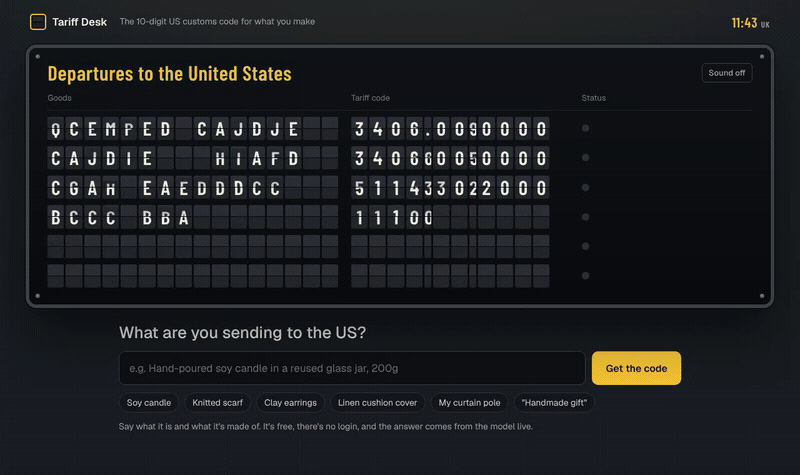
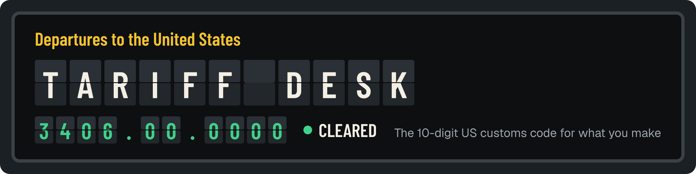

<p align="center"></p>

<p align="center"></p>

<p align="center"><b>Describe what you make. Get the 10-digit US customs code your parcel needs.</b><br>
A small open model (Qwen3-8B) fine-tuned on Tinker, reading the US Customs rulings closest to your product before it answers.</p>

<p align="center"><a href="https://tariff-desk.onrender.com">Try it</a> · <a href="#results">Results</a> · <a href="data/key">Answer key</a> · <a href="pipeline">Pipeline</a></p>

I've sold wooden curtain poles on Etsy since 2020. Since the US ended de minimis in August 2025, every parcel I send to an American buyer needs a tariff code, and since 9 July 2026 Etsy wants sellers outside the US to ship with the duties paid. CBP's postal rule asks for "all applicable 10-digit HTSUS classification(s)" on every mail entry, with a compliance date of 22 October 2026. "Handmade gift" on the customs form doesn't cut it any more.

Tariff Desk is the tool I wanted: type the item the way you'd write it in a listing, get the code, the US duty from the official schedule, and a customs line you can paste into the label. If the description is too vague to classify, it asks you the one question it needs instead of guessing.

| Try this | Watch what happens |
|---|---|
| [Open the page](https://tariff-desk.onrender.com) and click **Soy candle** | The board flips to 3406.00.0000, backed by 12 of the 12 most similar past rulings, duty Free |
| Click **"Handmade gift"** | It asks what the item is and what it's made of, while the untrained model invents a code |
| Click **My curtain pole** | It's not sure, so it shows its best guess (other articles of wood, 4421.99.9880) and asks which of five codes is closest |

## The problem, in numbers

- CBP processed over **1.36 billion** de minimis shipments in fiscal 2024 ([Federal Register 2026-12669](https://www.federalregister.gov/documents/2026/06/24/2026-12669/indefinite-suspension-of-the-de-minimis-exemption-for-mail-shipments-and-new-postal-informal-entry)). Those parcels now need a 10-digit code each.
- Etsy made duties-paid shipping compulsory for sellers outside the US from **9 July 2026**, and a seller who ships duties-unpaid can end up paying the refund ([Etsy Seller Handbook](https://www.etsy.com/seller-handbook/article/1355662653395)).
- The US schedule has about 20,000 ten-digit lines, and a general model guesses ones that look right. Asked about {{sets.unseen_n}} recent rulings, an untrained Qwen3-8B gave a real code {{runs.base.unseen.valid}} times.

## Results

Every answer below is marked against one of **{{sets.unseen_n}} binding rulings US Customs issued in June, July and August 2026**, after every model here was trained and after the training data was collected. Exact means all ten digits match the ruling. Same prompt for every model; "with past rulings" means each model reads the same 12 most similar rulings from a library of {{library.n_fmt}}.

| Model | Exact (of {{sets.unseen_n}}) | Right to 6 digits | Real codes | Asks when the listing is vague (of {{sets.adv_ask_n}}) |
|---|---|---|---|---|
| Qwen3-8B, untrained | {{runs.base.unseen.exact}} | {{runs.base.unseen.d6}} | {{runs.base.unseen.valid}} | {{runs.base.adversarial.ask_pass}} |
| Qwen3-8B, fine-tuned on Tinker | **{{runs.tuned_plain.unseen.exact}}** | {{runs.tuned_plain.unseen.d6}} | {{runs.tuned_plain.unseen.valid}} | {{runs.tuned_plain.adversarial.ask_pass}} |
| Qwen3-8B, untrained, with past rulings | {{runs.base_rag.unseen.exact}} | {{runs.base_rag.unseen.d6}} | {{runs.base_rag.unseen.valid}} | {{runs.base_rag.adversarial.ask_pass}} |
| **Tariff Desk: fine-tuned, with past rulings** | **{{runs.tuned.unseen.exact}}** | {{runs.tuned.unseen.d6}} | {{runs.tuned.unseen.valid}} | **{{runs.tuned.adversarial.ask_pass}}** |
| Qwen3.5-397B (about 50 times the parameters), with past rulings | {{runs.big.unseen.exact}} | {{runs.big.unseen.d6}} | {{runs.big.unseen.valid}} | {{runs.big.adversarial.ask_pass}} |

What I take from it:

- **Fine-tuning taught the 8B the job.** On its own it went from {{runs.base.unseen.exact}} to {{runs.tuned_plain.unseen.exact}} exact codes (paired bootstrap over the {{sets.unseen_n}} rulings: +{{pairs.ft-v1_vs_base-qwen3-8b_unseen.exact.diff_pts}} points, 95% interval {{pairs.ft-v1_vs_base-qwen3-8b_unseen.exact.ci_text}}), and from {{runs.base.unseen.valid}} to {{runs.tuned_plain.unseen.valid}} real codes.
- **Past rulings do the heavy lifting on accuracy.** Given the same rulings, the untrained 8B gets close to the fine-tuned one on exact matches; the difference (+{{pairs.ft-v2-lean_vs_base-qwen3-8b-rag_unseen.exact.diff_pts}} points, 95% interval {{pairs.ft-v2-lean_vs_base-qwen3-8b-rag_unseen.exact.ci_text}}) sits inside the noise. What the fine-tune adds there is behaviour: it asks instead of guessing on {{runs.tuned.adversarial.ask_pass}} of {{sets.adv_ask_n}} vague listings, where the untrained model, given the same rulings, asks on {{runs.base_rag.adversarial.ask_pass}}.
- **The big model is better, and costs more.** Qwen3.5-397B with the same rulings gets {{runs.big.unseen.exact}}. Per code it costs about {{cost.big_vs_tuned}} times as much at Tinker's published prices.

**One answer, or one question.** The page shows a code when it's confident: at least 3 of the 12 similar rulings used it and it doesn't contradict a material the seller named. That happened {{answer.conf}} times on the unseen set, and {{answer.conf_right}} matched CBP's ruling. When it isn't sure, it shows its best guess and asks "which of these is closest to your item?" with up to five codes in the schedule's own words; the right code was in that list {{answer.unsure_in_options}} times out of {{answer.unsure}}. Altogether the right code was on screen for {{answer.shown_right}} of {{sets.unseen_n}}. A few plain-code rules sit on top (`pipeline/answer.py`, `pipeline/materials.py`): a wooden item never leads with a metal or raw-timber code, oak doesn't get the bamboo line, and headings whose own wording settles it (dog coats "of any material" in 4201, greeting cards, wooden picture frames, toys) win over the model. They took the lead answer from {{qa.unseen_old_best}} to {{answer.best_right}} exact codes on the unseen set and from {{qa.makers_old_best}} to {{qa.makers_best}} of {{sets.makers_n}} on the maker listings. On {{qa.holdout_n}} realistic listings in `qa/` the lead answer had the right heading on {{qa.holdout_best}} of {{qa.holdout_coded}} (the old page: {{qa.holdout_old_best}}; I fixed bugs these listings exposed, so treat that as a sanity check, not a clean test).

## How it works

1. **Precedent lookup (plain code).** BM25 over {{library.n_fmt}} past CBP rulings: {{library.n_cross_fmt}} ruling subjects from CBP's CROSS database dated before June 2026, plus the public CROSS training questions. It returns the 12 closest rulings and the schedule's wording for their codes. Same block in training, evaluation and on the live page (`pipeline/precedents.py`).
2. **The model.** Qwen3-8B with a LoRA (rank 32) trained on Tinker: v1 on 19,740 examples without precedents, v2 on 5,000 examples with them, including vague listings answered with a question and listings with codes injected into the text.
3. **The guard (plain code).** Every code is checked against the current HTSUS export from USITC. A code that doesn't exist is shown as not real; the duty and the schedule wording come from the export, never from the model.

The live page runs on Render (FastAPI, `server/app.py`) and samples the fine-tuned weights through Tinker's OpenAI-compatible endpoint.

## The answer key

Written before any model ran, and kept apart from training:

- **Unseen:** {{sets.unseen_n}} CBP NY rulings issued June to August 2026, each with one 10-digit code that exists in today's schedule. A large model turned each ruling into a plain description of the goods; any description containing a tariff number or the word heading was thrown out. `data/key/unseen.jsonl`
- **Makers:** {{sets.makers_n}} products written the way a seller writes a listing, each keyed to a 2025 or 2026 CBP ruling. `pipeline/maker_set.py`
- **Adversarial:** {{sets.adv_ask_n}} vague listings ("Personalised keepsake, any name, any colour") where the right answer is a question, and {{sets.adv_inj_n}} listings with a code or an instruction pasted into the text. `pipeline/adversarial_set.py`

Every model output is in `data/runs/`, and `pipeline/score.py` recomputes every number in this README.

## Cost

Everything, from building the answer key to both fine-tunes and all the comparisons, came to about ${{cost.total_usd}} at Tinker's published prices (an upper bound; `data/ledger.json`). One classification on the live page costs about ${{cost.tuned_per_code}}.

## Limits

- An exact code on about a quarter of rulings is a start, not a broker. The page says how well each answer is backed and points high-value items to a customs broker.
- The precedent library only holds rulings whose code still exists in today's schedule, so some old but relevant rulings are missing. That's why the model got my own wooden curtain poles wrong (it found rulings for metal and plastic rods); the material rules now catch it and lead with the right line.
- US only, and only the classification: no landed-cost calculation, and no Section 232 or other additional duties.

## Run it yourself

```bash
pip install -r server/requirements.txt
export TINKER_API_KEY=...
uvicorn server.app:app --port 8787
```

The pipeline (`pipeline/`) rebuilds the answer key, the training data, both fine-tunes and every score; see the docstring at the top of each script.

## Credits

Base model Qwen3-8B (Apache-2.0). Training questions from the public CROSS rulings dataset released with the ATLAS paper (arXiv:2509.18400). Rulings from U.S. Customs and Border Protection's CROSS database and the tariff schedule from the U.S. International Trade Commission (both public). Built for the DEV Hacktoberfest 2026 "Side Hustle" challenge. MIT licence.
